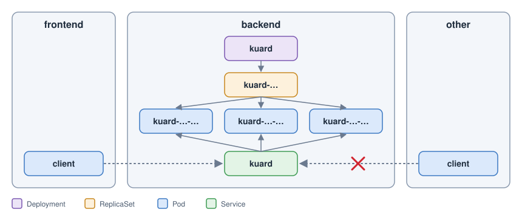

# NetworkPolicy

By default every Pod can reach every other Pod, even across namespaces. A NetworkPolicy restricts which traffic a Pod accepts (ingress) or sends (egress).

This demo runs kuard in the `backend` namespace and a `busybox` client in both `frontend` and `other`. The goal: only `frontend` may reach the backend.



## Prerequisites

The cluster must enforce NetworkPolicies. Both k3s and Rancher Desktop do this out of the box with their embedded network policy controller.

## Apply

```bash
kubectl apply -f kuard.yml
```

## See the effect

Both clients can reach the backend:

```bash
kubectl exec -n frontend client -- wget -qO- -T 2 http://kuard.backend:8080/healthy
kubectl exec -n other client -- wget -qO- -T 2 http://kuard.backend:8080/healthy
```

### Deny all ingress

`default-deny.yml` selects every Pod in `backend` (`podSelector: {}`) and allows no ingress:

```bash
kubectl apply -f default-deny.yml
```

Repeat both `wget` commands: both fail now.

### Allow the frontend

`allow-frontend.yml` allows traffic to `app: kuard` on port 8080, but only from Pods in the `frontend` namespace:

```bash
kubectl apply -f allow-frontend.yml
```

Repeat both `wget` commands: `frontend` gets through, `other` is still blocked.

Policies are additive: traffic is allowed when at least one policy that selects the Pod allows it. That is why combining a default deny with specific allow rules works.

```bash
kubectl get networkpolicy -n backend
kubectl describe networkpolicy allow-frontend -n backend
```

### Selectors

- `podSelector` in `spec` — the Pods the policy applies to.
- `namespaceSelector` in `from` — allow all Pods in matching namespaces.
- `podSelector` in `from` — allow matching Pods in the policy's own namespace.
- Both in one `from` entry — allow matching Pods in matching namespaces only.

The ingress controller is a Pod too. A default deny in a namespace also blocks traffic from Traefik, unless you allow it explicitly.

## Challenges

### Restrict egress

Add a policy in the `frontend` namespace that restricts egress: the client may only reach the backend on port 8080, nothing else.

Hints:

- Use `policyTypes: [Egress]`.
- Test with `wget` to the backend and to `http://example.com`.
- If you get `bad address`, think about what the client does before it connects to `kuard.backend`. Check `kubectl get pods -n kube-system --show-labels`.

### Allow within the namespace

Add two clients to the `backend` namespace, next to kuard:

```bash
kubectl apply -f challenge.yml
kubectl exec -n backend trusted -- wget -qO- -T 2 http://kuard:8080/healthy
kubectl exec -n backend untrusted -- wget -qO- -T 2 http://kuard:8080/healthy
```

Both fail: the default deny also blocks Pods in the same namespace. Add a policy so that only `trusted` can reach kuard.

Hints:

- Compare the labels: `kubectl get pods -n backend --show-labels`.
- Look at the Selectors section above: which selector in `from` matches Pods in the policy's own namespace?
- `frontend` must still get through.

## Clean up

```bash
kubectl delete -f kuard.yml
```

Deleting the namespaces also deletes the policies in them.
